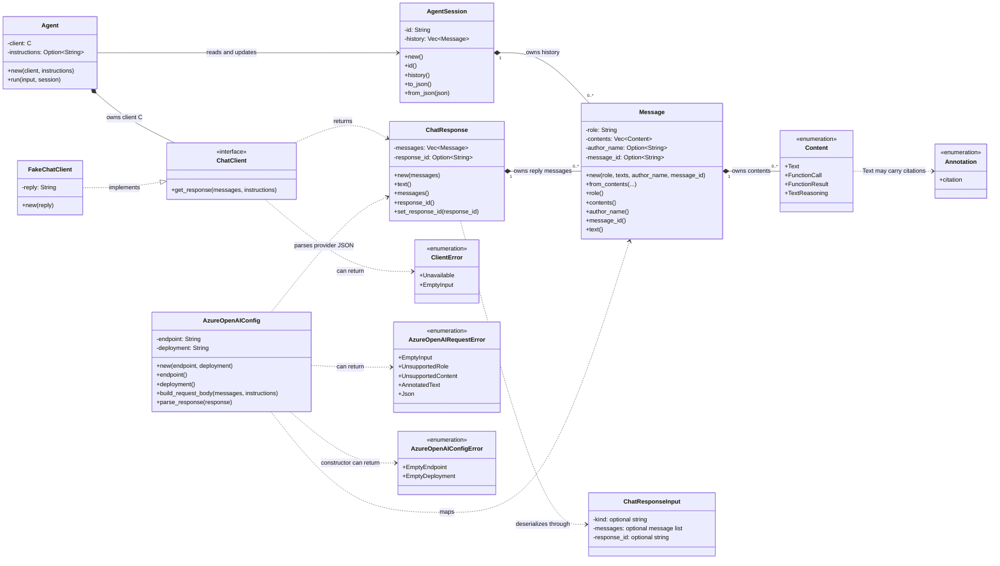
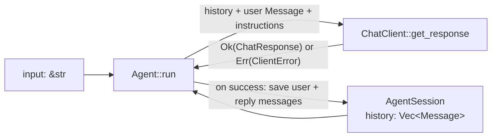
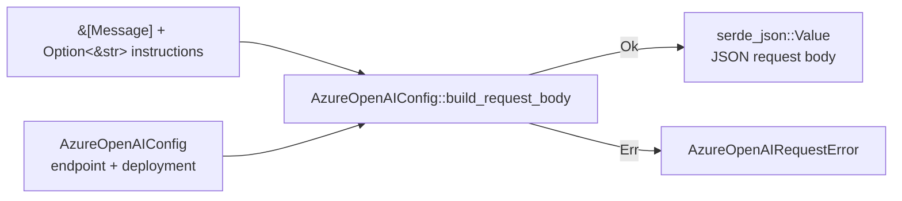
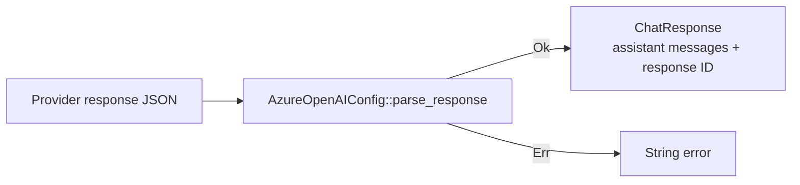

# Rust MAF map

This is a quick reference to the **current learning-project subset**. It is
not a map of every feature in Microsoft Agent Framework. The editable visual
map is [rust-maf-map.excalidraw](./rust-maf-map.excalidraw); the Mermaid
diagrams below are rendered in VS Code's Markdown preview and on GitHub.

## If you remember only one thing

**Agent runs a turn. Session remembers turns. Message is one turn. Content is
what a turn contains. ChatClient is the model-call boundary.**

The Azure code has separate, offline request and response mappers. It does not
implement `ChatClient` and does not send an HTTP request.

## Main types and relationships



`Agent<C: ChatClient>` means the agent is written to use any type that
implements the `ChatClient` trait. Today, `FakeChatClient` implements it.
`AzureOpenAIConfig` is **not wired into this trait yet**.

The arrow with a filled diamond means the left-hand type owns the values in
its vector. The dotted relationship to `ChatResponseInput` is different: that
private struct is only a Serde helper used when reading response JSON.

## Follow one normal agent turn



In plain language:

1. `Agent::run` rejects blank user input.
2. It turns the input string into a user `Message`.
3. It sends the old session history plus the new user message to the client.
4. It keeps the new conversation in a temporary list until the client succeeds.
5. On success, it replaces the session history with the user and reply messages.
6. On failure, it returns an error and leaves the original session unchanged.

`ChatResponse` is the response envelope. It contains reply messages and an
optional response ID. `ChatResponse::text()` joins message text with newlines
and trims whitespace at the outside. `AgentSession` stores the conversation
messages; it does not store the whole response envelope or its response ID.
The private `ChatResponseInput` helper reads response JSON, and the conversion
accepts a missing message list as empty while checking a supplied type tag.

## Follow one message into its data

```text
Message
  role: String                 who spoke, such as "user" or "assistant"
  contents: Vec<Content>       an ordered list of content items
    Text                       text, with optional citation annotations
    FunctionCall               a requested function and its call ID
    FunctionResult             result data and its call ID
    TextReasoning              optional reasoning-related text
```

`Message::new(role, vec_of_strings, ...)` is the shortcut for ordinary text.
It converts each string into `Content::Text`. Use `Message::from_contents`
when you need a specific content variant. `Message::text()` joins ordinary
Text items with spaces; it does not turn calls, results, reasoning, or
citation metadata into answer text.

| Content variant | Data it carries |
| --- | --- |
| `Text` | `text: String`; `annotations: Option<Vec<Annotation>>` |
| `FunctionCall` | `call_id: String`; `name: String`; optional JSON `arguments` |
| `FunctionResult` | `call_id: String`; optional JSON `result`; optional `items: Vec<Content>` |
| `TextReasoning` | optional `text: String` |

`Content::text()` returns `Some(text)` only for `Text`; it returns `None` for
the other variants.

The current citation subset is:

```text
Content::Text {
    text: String,
    annotations: Option<Vec<Annotation>>
}

Annotation::citation { title: Option<String>, url: Option<String> }
```

`ChatResponse` is serialized with the `"type": "chat_response"` tag. Its
private `ChatResponseInput` helper is only for deserialization: the incoming
type is optional, a missing `messages` list becomes empty, and a different
nonempty type tag is rejected.

`Content` and `Annotation` also serialize with a `"type"` tag and
snake_case variant names. The core `Message` struct itself has no Serde type
tag; the Azure request builder adds `"type": "message"` when it creates the
provider JSON item.

The mapper accepts no annotations (`None` or an empty list) and rejects a
nonempty list for now. It does not silently erase citations.

## Separate path: Azure request and response mapping



The builder currently handles this deliberate first subset:

| Input | Request JSON |
| --- | --- |
| User Text | Message content type `input_text` |
| Assistant Text history | Message content type `output_text`, with `annotations: []` |
| `Some(instructions)` | Top-level `instructions` field, including `Some("")` |
| `None` instructions | No `instructions` field |
| Empty-content messages | Skipped; `EmptyInput` if no prepared items remain |
| Role other than user or assistant | `UnsupportedRole` |
| Unsupported content or nonempty citation annotations | Explicit request error |

Every mapped message also has `"type": "message"` and its `role`. The
configured deployment becomes the top-level `"model"`. The endpoint is kept
for future transport and is **not** part of the JSON body.

The configuration constructor rejects exactly empty endpoint or deployment
strings using `AzureOpenAIConfigError`. It does not validate whitespace or
the full endpoint URL.

The builder creates JSON; the separate parser reads a provider response JSON
value. Neither authenticates, connects to Azure, sends HTTP, or implements
`ChatClient`. Those are future exercises.

### Mapping a response



For the current text-only subset, `parse_response` requires a string response
ID and an `output` array. It accepts output messages with a string message ID,
role `assistant`, and `output_text` content with string text and an empty
annotations array. It rejects unsupported output kinds, content kinds,
non-assistant roles, and nonempty annotations with an error. When `output`
is empty, it returns one empty assistant message without a message ID.

The parser keeps response and message IDs separate. Two messages with distinct
IDs are tested in order. Other response metadata is not preserved, and parity
for repeated or missing message IDs is not established. The parser currently
ignores response status, so a failed response with empty output can appear
successful. It is not complete provider-schema validation; its errors are
currently `String` values.

`ClientError` belongs to the agent/client boundary. `AzureOpenAIRequestError`
belongs to request mapping; response mapping currently returns a `String`.
No network error mapping exists yet.

## Rust notation cheat sheet

| Notation | Say it as | Example from this project |
| --- | --- | --- |
| `Vec<T>` | An ordered growable list of `T` values | `Vec<Message>` is a list of messages |
| `Option<T>` | Maybe one `T`: `Some(value)` or `None` | `Option<String>` is optional instructions |
| `Result<T, E>` | Either success `Ok(T)` or error `Err(E)` | `Result<ChatResponse, ClientError>` |
| `&T` | Borrow and read a value without taking ownership | `&Message` |
| `&[T]` | Borrow a read-only list | `&[Message]` |
| `&str` | Borrowed string text | `message.role() -> &str` |
| `C: ChatClient` | `C` must implement the `ChatClient` contract | The client type used by `Agent<C>` |

## What can be imported from the crate

The crate root re-exports `Agent`, `ChatClient`, `ClientError`,
`FakeChatClient`, `AgentSession`, `ChatResponse`, `Message`, `Content`,
`Annotation`, `AzureOpenAIConfig`, `AzureOpenAIConfigError`, and
`AzureOpenAIRequestError`. `ChatResponseInput` and `FailingClient` are
internal helpers, not part of that public list.
`FakeChatClient` returns a configured assistant-text reply; the
crate-private `FailingClient` exists to exercise the client-error path.

## How engineers keep this straight

Software engineers do **not** memorize every class and field. They use maps
like this, type names, tests, IDE symbol navigation, and small traces through
the code. When you get lost, ask:

1. **Who is coordinating?** `Agent`.
2. **Where is history kept?** `AgentSession`.
3. **What is one turn made of?** `Message` and its `Content`.
4. **Where does the model-call promise live?** `ChatClient`.
5. **Is the Azure code connected yet?** No; it only maps JSON offline.

Then follow one arrow or one test at a time. This map should change as the
project changes; it is a navigation aid, not something you need to memorize.
